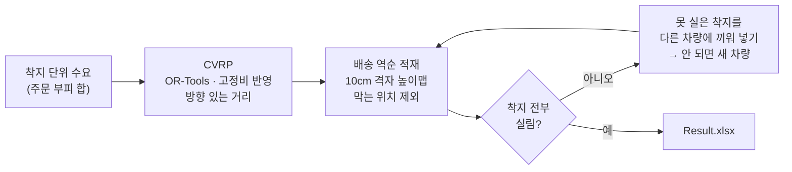

# AI 기반 배송 라우팅·적재 순서 최적화

> 차량 경로(VRP)와 3D 적재를 결합해, 하차 시 재취급 비용까지 반영한 배송 계획으로 전체 물류 비용을 최소화하는 최적화 알고리즘

**2025 CJ대한통운 미래기술챌린지** · 팀 `문 앞에 놔주세요` (2025.06 – 07) · 최종평가 **11위** · **2026.11 개인 개선**

`Python` · `Google OR-Tools` · `Vehicle Routing Problem` · `3D Packing Heuristic` · `NumPy` · `pandas`

> **이 저장소에 대해**
> 대회 제출 당시 코드는 [`v1-team-submission`](../../tree/v1-team-submission) 태그에 그대로 남아 있습니다.
> 이후 커밋은 제가 과제 설명서의 평가 기준으로 채점기를 만들어 제출본을 다시 채점하고, 드러난 문제를 고친 개인 작업입니다. 아래 [개선 기록](#개선-기록-202611)에 정리했습니다.

---

## 개요

물류센터에서 출발하는 여러 배송 차량에 주문을 배정하고, 각 차량의 **방문 순서와 박스 적재 위치를 함께 결정**해 전체 배송 비용을 최소화하는 과제입니다.

- 라우팅 비용 = 차량 수 × 150,000원 + 이동 거리 × 500원/km
- 하차 비용 = 셔플링 횟수 × 500원 (셔플링: 박스를 꺼내기 위해 옮겨야 하는 주변 박스 수)
- 적재함 160(X) × 280(Y) × 180(Z) cm, 문은 Y=280 쪽, 후입선출
- 각 착지는 차량 한 대가 한 번만 방문, 실행 시간 20분 제한

## 대회 성과 (팀 제출본)

| 구분 | 점수 | 순위 |
| --- | --- | --- |
| 중간평가 | 5,855,970 원 | 13위 |
| 최종평가 | **10,981,370 원** | **11위** |

> 점수는 낮을수록 상위(비용 최소화). 중간평가와 최종평가는 적용 데이터셋이 다릅니다.

## 개선 기록 (2026.11)

### 0. 과제 설명서 기준 채점기 작성
제출본은 비용을 스스로 계산해 출력했지만, 그 계산이 맞는지 확인할 방법이 없었습니다. [`evaluation/evaluate.py`](evaluation/evaluate.py)로 `Result.xlsx`를 설명서 기준으로 다시 채점합니다.

- 라우팅 비용(고정비·유류비), 하차 비용(셔플링)
- 박스 누락·중복, 박스 겹침, 적재함 범위 초과, 한 착지를 여러 차량이 방문했는지 검사
- 셔플링 판정: 착지 순서대로 내리면서, 내릴 박스의 **위**나 **문 쪽 앞**에 있는 다른 착지 박스를 치운다고 보고 막는 관계를 끝까지 따라가 셉니다. 설명서에는 "꺼내기 위해 이동해야 하는 주변 상품의 수"까지만 나와 있어 세부 판정은 제가 정했고, **공식 채점기와 다를 수 있습니다.**

### 1. 제출본을 다시 채점해서 찾은 문제

개발용 데이터(주문 437건, 착지 300곳)

| 항목 | 제출본이 출력한 값 | 채점기 결과 |
| --- | --- | --- |
| 셔플링 | 67회 | **600회** |
| TOTAL SCORE | 1,150,730원 | **1,419,002원** |
| 여러 차량에 나뉜 착지 | (검사 안 함) | **70곳** |
| 실행 시간 | 315초 | 권장 5분 초과 |

- **셔플링을 9배 적게 세고 있었습니다.** 같은 착지 박스끼리만 비교해, 다른 착지 박스가 위나 앞에서 막는 경우가 빠졌습니다.
- **문 반대쪽부터 채웠습니다.** 문은 Y=280인데 박스를 Y=0(가장 안쪽)부터 부피 순으로 넣어, 먼저 내릴 박스가 안쪽에 갇혔습니다. 배송 순서 정렬 직후 부피 정렬을 다시 해서 배송 순서가 사실상 반영되지 않았습니다.
- **착지 분할**: 남은 주문을 부피 순으로 차량에 채워, 한 착지의 박스가 여러 차량에 나뉘었습니다 ("각 착지는 차량 한 대가 한 번만 방문" 규칙 위반).
- **거리 행렬**: 제공 OD 행렬은 A→B와 B→A 거리가 다른데, 읽을 때 한쪽 값으로 덮어써 대칭으로 만들었습니다.

### 2. 다시 설계한 방식



1. **착지 단위 CVRP** — 착지마다 주문 부피를 합쳐 수요로 두고, 차량 배정과 방문 순서를 OR-Tools로 함께 풉니다. 차량 고정비를 목적함수에 넣어 차량 수와 거리를 같은 단위(원)로 비교합니다. 착지는 한 차량에만 배정됩니다.
2. **배송 역순 적재** — 마지막 착지 박스부터 적재함 안쪽에 싣습니다. 새 박스의 문 쪽 앞에 '나중에 내릴' 박스가 있는 위치는 후보에서 빼서, **하차할 때 셔플링이 생기지 않게** 했습니다. 박스는 각 칸의 현재 높이 위에만 놓고 바닥 면적의 60% 이상이 받쳐져야 합니다.
3. **멀티스타트** — 위치 우선순위 규칙 5가지 × 착지 안 박스 순서 2가지로 실어 보고, 못 실은 부피가 가장 작은 결과를 고릅니다(경로 하나에 0.2~0.7초).
4. **적재 실패 처리** — 부피로는 맞아도 3D로 안 들어가는 착지는 거리 증가가 작은 다른 차량에 끼워 넣어 보고, 안 되면 새 차량을 씁니다.
5. **CVRP 용량 비율** — 셔플링 0 조건에서 실제로 실리는 비율이 적재함의 약 80%라, 용량을 0.72~0.88로 바꿔 비교한 뒤 0.80을 골랐습니다.

| CVRP 용량 비율 | 0.72 | 0.76 | **0.80** | 0.84 | 0.88 |
| --- | --- | --- | --- | --- | --- |
| TOTAL SCORE (원) | 1,089,616 | 1,087,473 | **1,083,124** | 1,087,350 | 1,105,270 |

### 3. 결과

같은 채점기, 개발용 데이터(주문 437건)

| 항목 | 제출본 | 개선 |
| --- | --- | --- |
| 차량 수 | 5대 | 6대 |
| 이동 거리 | 738.0 km | **366.2 km** |
| 라우팅 비용 | 1,119,002원 | 1,083,124원 |
| 셔플링 | 600회 (300,000원) | **0회** |
| **TOTAL SCORE** | **1,419,002원** | **1,083,124원 (−23.7%)** |
| 여러 차량에 나뉜 착지 | 70곳 | **0곳** |
| 실행 시간 | 315초 | **66초** |

- 차량은 1대 늘었지만(+150,000원), 지리적으로 가까운 착지끼리 묶어 거리가 절반이 되고 셔플링이 없어져 총비용이 줄었습니다.
- 세 번 실행해 같은 결과가 나왔습니다. 다만 CVRP는 60초 시간 제한 탐색이라 느린 컴퓨터에서는 결과가 달라질 수 있습니다.

평가용 데이터 규모(주문 1,000건 이상) 확인: 같은 착지 300곳에 주문 1,000건을 무작위로 배정한 데이터로 실행

| 항목 | 제출본 | 개선 |
| --- | --- | --- |
| TOTAL SCORE | 결과 없음 (시간 초과) | **2,214,046원** (13대, 528.1 km, 셔플링 0회) |
| 실행 시간 | **25분 안에 끝나지 않음** (제한 20분) | **70~84초** (2회 실행) |

### 한계
- 셔플링 판정 기준은 설명서를 바탕으로 제가 정한 것이라 공식 채점 결과와 다를 수 있습니다.
- 셔플링을 0으로 고정해, 셔플링 몇 번으로 차량 한 대를 줄이는 선택(차량 1대 = 셔플링 300회)은 아직 하지 않습니다.
- 적재는 박스를 세운 채 90도 회전만 허용합니다(눕히는 회전은 시험했으나 적재율이 오르지 않음).

## 프로젝트 구조

```text
main.py                   # 실행 코드 (CVRP + 배송 역순 적재)
evaluation/evaluate.py    # 과제 설명서 기준 채점기
debug.py                  # 대회 당시 팀 실험 코드 (다중 차량 CVRP 시도)
requirements.txt
```

## 실행 방법

```bash
pip install -r requirements.txt
python main.py data.json distance-data.txt          # → Result.xlsx
python evaluation/evaluate.py data.json distance-data.txt Result.xlsx
```

## 대회 당시 접근 (팀 제출본)

경로와 적재를 나눠 풀고 하나의 배송 계획으로 연결했습니다. OR-Tools Routing Solver로 방문 순서를 계산하고, 차량 내부를 3차원 좌표로 두어 박스를 배치했으며, 결과를 대회 형식(`Result.xlsx`)으로 자동 변환해 전략별 결과를 비교했습니다. 제출 마감이 있는 환경에서 완전한 최적해보다 기한 안에 동작하는 결과를 먼저 확보했습니다.

## 팀 프로젝트

2025 CJ대한통운 미래기술챌린지를 팀 **문 앞에 놔주세요**로 참가해 함께 개발했습니다.

## 데이터 안내

`data.json`, `distance-data.txt` 등 대회에서 제공한 입력 데이터와 샘플 코드(`Sample.py`), 제공 데이터가 포함된 제출 결과 화면(`result.png`), 실행 결과(`outputs/`)는 공개가 허용되지 않아 저장소에 포함하지 않았습니다. 참가자가 직접 작성한 알고리즘 코드만 공개합니다.
