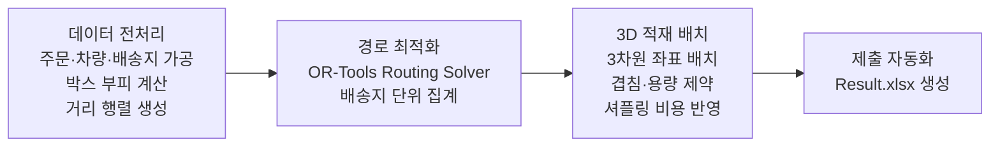

# AI 기반 배송 라우팅·적재 순서 최적화

> 차량 경로(VRP)와 3D 적재를 결합해, 하차 시 재취급 비용까지 반영한 배송 계획으로 전체 물류 비용을 최소화하는 최적화 알고리즘

**2025 CJ대한통운 미래기술챌린지** · 팀 `문 앞에 놔주세요` (2025.06 – 07) · 🏆 최종평가 라우팅 부문 **11위**

`Python` · `Google OR-Tools` · `Vehicle Routing Problem` · `3D Packing Heuristic` · `pandas` · `openpyxl`

---

## 개요

물류센터에서 출발하는 여러 배송 차량에 주문을 배정하고, 각 차량의 **방문 순서와 박스 적재 위치를 함께 결정**해 전체 배송 비용을 최소화하는 과제입니다. 차량 용량·박스 크기·배송 순서뿐 아니라, 하차 시 다른 박스를 옮겨야 하는 **셔플링 비용**까지 고려해야 하므로, 경로 최적화와 3D 적재 최적화를 결합하는 방식으로 접근했습니다.

## 성과

| 구분 | 점수 | 순위 |
| --- | --- | --- |
| 중간평가 | 5,855,970 원 | 13위 |
| 최종평가 | **10,981,370 원** | **11위** (라우팅 부문) |

> 점수는 낮을수록 상위(비용 최소화). 중간평가와 최종평가는 적용 데이터셋이 다릅니다.

## 접근 방식



핵심은 **VRP와 3D Packing을 각각 독립적으로 처리하되, 최종적으로 하나의 배송 계획으로 연결**한 점입니다. 배송지 간 거리를 비용으로 설정해 OR-Tools Routing Solver로 방문 순서를 계산하고, 모든 주문을 배송지 단위로 묶어 계산량을 줄여 대회 기간 내 제출 가능한 결과를 빠르게 생성했습니다. 이후 확정된 배송 순서를 기준으로 차량 내부를 3차원 좌표계로 두고 박스를 배치했습니다.

## 핵심 구현

1. **데이터 전처리** — `data.json`에서 물류센터·배송지·주문·차량을 로드하고 박스 부피를 계산, `distance-data.txt`로 거리 행렬을 구성
2. **VRP 기반 경로 최적화** — OR-Tools Routing Solver로 차량별 최단 방문 순서 계산, 배송지 단위 집계로 계산량 절감
3. **3D 적재 휴리스틱** — 차량 내부를 3차원 좌표계로 설정해 박스 겹침·용량 초과를 방지하고, 배송 순서상 먼저 내릴 박스가 접근 가능한 위치에 실리도록 적재 순서 설계
4. **셔플링 비용 모델링** — 먼저 내려야 할 박스가 뒤에 깔리거나 접근이 막히는 경우를 비용으로 반영해, 단순 이동 거리 최소화를 넘어 실제 하차 과정까지 고려
5. **제출 자동화** — 차량 번호·배송 순서·박스 좌표 등을 대회 형식(`Result.xlsx`)으로 자동 변환해 여러 전략을 빠르게 실험·비교

## 기술 스택

`Python` · `Google OR-Tools` (Routing Solver) · `pandas` · `openpyxl` · Vehicle Routing Problem · 3D Packing Heuristic

## 프로젝트 구조

```text
main.py               # 제출용 실행 코드
debug.py              # 디버깅용 (로그 포함)
data.json             # 물류센터·배송지·주문·차량 정보
distance-data.txt     # 배송지 간 거리 데이터
```

## 실행 방법

```bash
pip install -r requirements.txt
python main.py data.json distance-data.txt
# → 대회 제출 형식의 Result.xlsx 생성
```

## 회고

성격이 다른 두 최적화 문제(경로·적재)를 독립적으로 풀되 하나의 실행 계획으로 통합하는 구조화 능력을 길렀고, 제출 마감이 있는 환경에서 완전한 최적해보다 **기한 내 동작하는 결과를 우선하는 엔지니어링 판단**을 경험했습니다. 향후 개선 방향으로는 경로·적재를 동시에 고려하는 통합 최적화, 박스 회전을 고려한 3D Packing, 적재 안정성·무게 중심 제약 추가를 고려할 수 있습니다.

## 팀 프로젝트

2025 CJ대한통운 미래기술챌린지를 팀 **문 앞에 놔주세요**로 참가해 함께 개발했습니다.
## 데이터 안내

`data.json`, `distance-data.txt` 등 대회에서 제공한 입력 데이터와 샘플 코드(`Sample.py`), 제공 데이터가 포함된 제출 결과 화면(`result.png`)은 공개가 허용되지 않아 저장소에 포함하지 않았습니다. 참가자가 직접 작성한 알고리즘 코드만 공개합니다.
